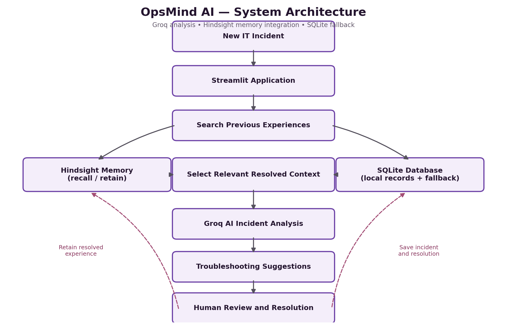
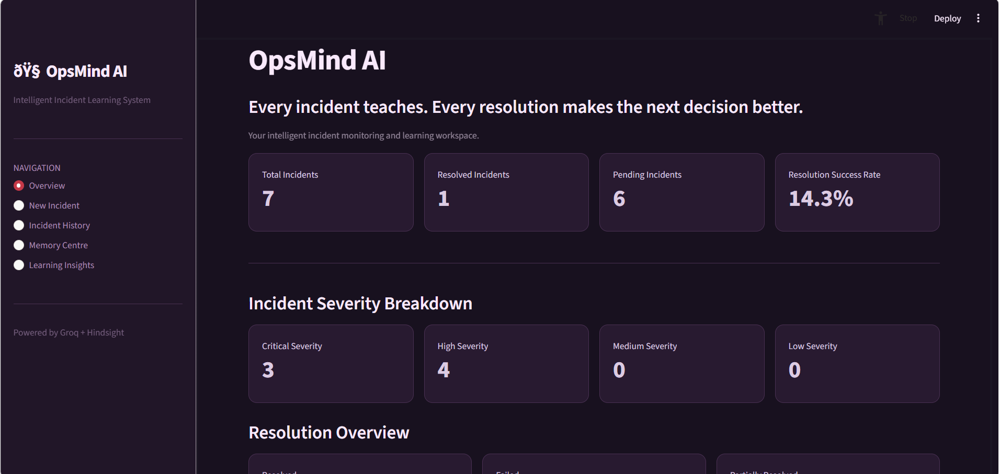
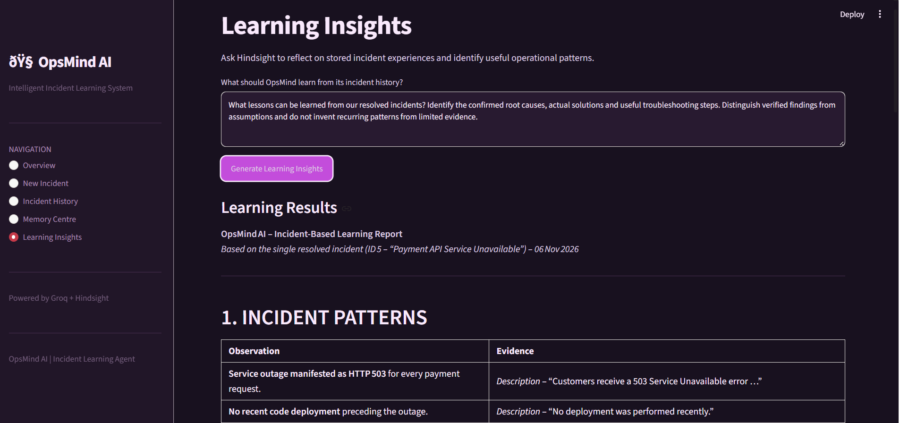
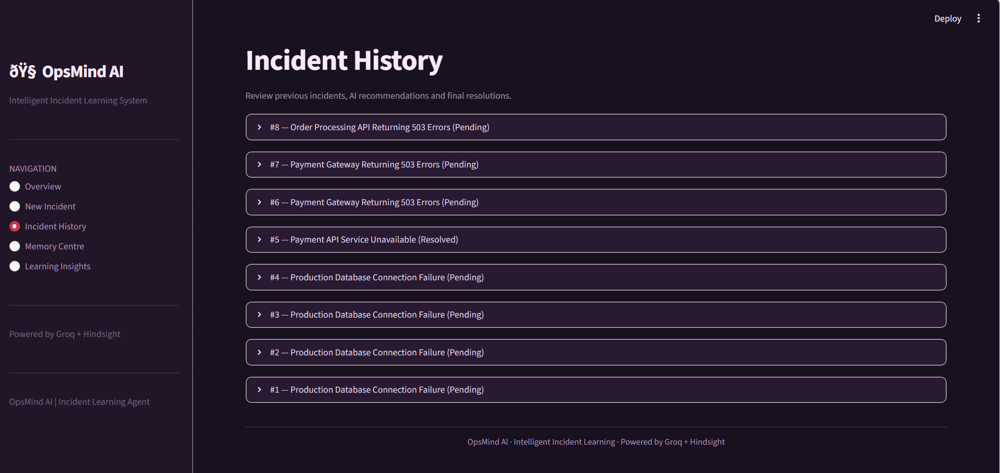
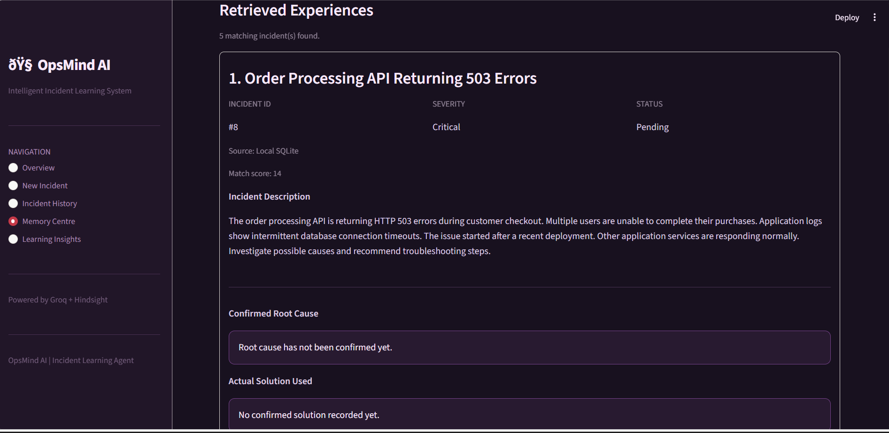
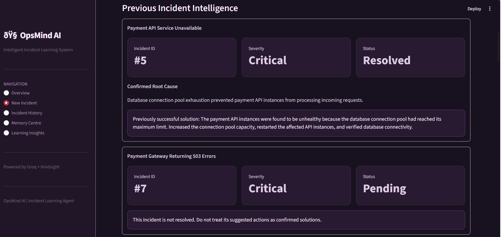

# Teaching an Incident Agent to Remember with Hindsight

*How I built OpsMind AI using Groq, Hindsight and SQLite.*

## 1. Introduction

Imagine a production system experiencing the same problem repeatedly. Every time the incident occurs, an engineer must investigate it, identify the root cause and find a solution.

Wouldn't it be better if an AI agent could use previous troubleshooting experiences to improve its next investigation?

This idea inspired me to build OpsMind AI, an intelligent incident-management application that combines AI-powered analysis with long-term memory.

The goal is simple: instead of treating every incident as a completely new problem, the application should be able to learn from previous experiences.

## 2. What is OpsMind AI?

OpsMind AI is a Streamlit-based application designed to help users investigate, track and learn from IT incidents.

It combines three important technologies:

- **Groq:** Provides AI-powered incident analysis and troubleshooting suggestions.
- **Hindsight:** Provides the long-term memory integration for retaining and retrieving incident experiences.
- **SQLite:** Stores local incident records and supports fallback retrieval.

The workflow has three stages:

1. **Analyze:** Understand a new incident using Groq.
2. **Remember:** Store resolved incident experiences.
3. **Learn:** Retrieve relevant historical information to support future investigations.

## 3. Why Hindsight?

AI models can generate useful responses, but they do not automatically remember every previous interaction.

This creates a challenge when building agents that need to learn from experience.

Hindsight provides a memory layer that allows AI applications to retain and retrieve information across interactions.

In OpsMind AI, I use Hindsight to store incident details, suggested solutions, actual solutions, outcomes and confirmed root causes.

This makes historical troubleshooting experiences available for future investigations.



*Figure 1: Architecture of OpsMind AI, showing incident analysis, memory retrieval, AI suggestions, and human review.*



*Figure 2: OpsMind AI dashboard showing the incident management overview.*

## 4. Integrating Hindsight

I separated the memory functionality into its own Python module rather than placing everything inside the main application.

The Hindsight client is initialized using environment variables:

```python
import os

from dotenv import load_dotenv
from hindsight_client import Hindsight

load_dotenv()

BANK_ID = "opsmind"

_client = None


def get_memory_client():
    global _client

    if _client is None:
        api_key = os.getenv("HINDSIGHT_API_KEY")
        base_url = os.getenv(
            "HINDSIGHT_BASE_URL",
            "https://api.hindsight.vectorize.io"
        )

        if not api_key:
            raise ValueError(
                "HINDSIGHT_API_KEY is missing in .env"
            )

        _client = Hindsight(
            base_url=base_url,
            api_key=api_key
        )

    return _client
```

This separation makes the application easier to maintain and keeps API configuration outside the main application logic.



*Figure 3: New Incident interface for submitting an IT incident for analysis.*

## 5. Retaining Resolved Incidents

One important design decision was distinguishing AI-generated suggestions from confirmed solutions.

An AI recommendation does not mean an incident has been resolved.

Therefore, OpsMind AI records the actual solution, outcome and confirmed root cause separately.

When an incident is resolved, the application sends its experience to Hindsight.

The application uses a wrapper function to pass the incident details to the memory engine:

```python
def remember_resolved_incident(incident):
    return retain_incident(
        incident_id=incident["id"],
        title=incident["title"],
        description=incident["description"],
        suggested_solution=incident["suggested_solution"] or "",
        actual_solution=incident["actual_solution"] or "",
        outcome=incident["outcome"],
        root_cause=incident["root_cause"] or ""
    )
```

The memory engine then builds a structured incident experience and sends it to Hindsight:

```python
def retain_incident(
    incident_id,
    title,
    description,
    suggested_solution,
    actual_solution,
    outcome,
    root_cause
):
    content = f"""
OPS MIND INCIDENT EXPERIENCE

Incident ID: {incident_id}
Title: {title}
Description: {description}

AI Suggested Solution:
{suggested_solution}

Actual Action Taken:
{actual_solution}

Outcome:
{outcome}

Confirmed Root Cause:
{root_cause}
"""

    return get_memory_client().retain(
        bank_id=BANK_ID,
        content=content,
        context="IT incident troubleshooting experience"
    )
```

This approach helps preserve useful troubleshooting knowledge instead of storing only AI-generated recommendations.

## 6. Recalling Previous Experiences

When a new incident is submitted, OpsMind AI searches for similar historical incidents.

The application first attempts to retrieve relevant memories through Hindsight.

If the external memory service is unavailable, it falls back to searching incident records stored in SQLite.

This fallback is important because an application should not become completely unusable when an external service is temporarily unavailable.

The local search considers information such as incident titles, descriptions, suggested solutions, actual solutions and root causes.



*Figure 4: Memory Centre displaying previously stored incident experiences using the local SQLite fallback.*

## 7. Connecting Memory with Groq

Retrieving previous experiences is useful only when the relevant information can support a new investigation.

OpsMind AI uses Groq to analyze new incidents. Information from previously resolved incidents can be included as additional context.

I also introduced a context-selection step. Although the application can display several matching incidents, it limits the historical context sent to Groq.

For example, the analysis call uses the selected historical context:

```python
suggestion = analyze_incident(
    title=title,
    description=description,
    severity=severity,
    previous_memories=memories_for_analysis[:1]
)
```

This helps keep the prompt focused and avoids sending unnecessary historical information.

The purpose is not to make the AI blindly repeat an old solution. Previous experiences provide context, while the new incident still requires investigation.

## 8. A Practical Testing Example

During testing, I recorded a critical incident:

**Incident:** Payment API Service Unavailable.

**Severity:** Critical.

**Confirmed root cause:** Database connection pool exhaustion prevented payment API instances from processing incoming requests.

**Actual solution:** Increased database connection pool capacity, restarted affected API instances and verified database connectivity.

This example demonstrates why recording actual resolutions matters.

If a similar payment API issue appears later, the previous experience may help prioritize checks related to database connectivity and connection pool capacity.

However, the new incident must still be investigated. A previous root cause should never automatically be treated as confirmed.



*Figure 5: Incident History showing a resolved payment API incident with its root cause and actual solution.*

## 9. Handling External Service Limitations

During development, I encountered an important limitation. Hindsight returned an HTTP 402 Payment Required response because the available account credits were insufficient.

Instead of allowing this external limitation to stop the application, I implemented a SQLite fallback for local incident retrieval.

This allowed me to continue testing the incident-management workflow and Groq analysis.

The SQLite fallback is not a replacement for Hindsight's memory capabilities. It is a reliability measure that keeps the application useful when the external service is unavailable.

This experience taught me that external integrations should always have sensible failure-handling strategies.

## 10. What I Learned

Building OpsMind AI helped me understand several important aspects of developing AI agents:

- AI-generated suggestions and confirmed solutions must be stored separately.
- Historical context should be relevant rather than excessive.
- Only resolved incidents should be treated as confirmed troubleshooting experiences.
- External service failures should not stop the entire application.
- AI recommendations must still be verified by humans.

Most importantly, memory should support better decisions, not replace human judgment.



*Figure 6: Learning Insights summarising patterns from resolved incident records.*

## 11. Conclusion

OpsMind AI explores how incident-management applications can become more useful by combining AI reasoning with long-term memory.

Groq provides AI-powered incident analysis, Hindsight provides the memory integration, and SQLite stores local incident records and supports fallback retrieval.

The external Hindsight integration still requires further validation once service access is available. Nevertheless, this project demonstrates an important concept: an AI agent should not simply respond to problems. It should use previous experiences to make future investigations more informed.

The ultimate goal is to move from an AI system that only analyzes incidents to one that can build upon previous troubleshooting experiences.

## Resources

1. [Hindsight GitHub](https://github.com/vectorize-io/hindsight)
2. [Hindsight Documentation](https://hindsight.vectorize.io/)
3. [What Is Agent Memory?](https://vectorize.io/what-is-agent-memory)